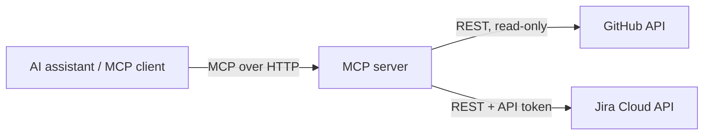

# Enterprise Integration MCP Server

A small [Model Context Protocol](https://modelcontextprotocol.io) (MCP) server that lets an AI assistant look up GitHub issues and Jira tickets through read-only tools.

> Proof of concept built on free tiers. See [Production notes](#production-notes) for what would change at scale.

## Tools

| Tool                  | What it does                                                                           | Input                        |
| --------------------- | -------------------------------------------------------------------------------------- | ---------------------------- |
| `fetch_public_issues` | Returns the latest 3 open issues from a public GitHub repo                             | `owner`, `repo`              |
| `fetch_jira_ticket`   | Returns a Jira ticket's summary, assignee, status, type, last-updated time, and a link | `ticket_key` (e.g. `DEMO-1`) |

Example prompts once connected:

- "What are the latest open issues in `modelcontextprotocol/python-sdk`?"
- "What's the status of DEMO-1?"

## How it works



The assistant reads each tool's description to decide when to call it. The server calls the upstream API and returns a short text summary.

## Prerequisites

- Python 3.10+
- An [Atlassian Cloud Free](https://www.atlassian.com/software/jira/free) site with at least one Jira ticket
- An MCP client (Claude Code, Claude Desktop, or the MCP Inspector)

## Setup

```bash
git clone <your-fork-url>
cd <repo-folder>
python3 -m venv venv
source venv/bin/activate
pip install -r requirements.txt
cp .env.example .env
```

Fill in `.env`:

| Variable         | Where to get it                                                                                    |
| ---------------- | -------------------------------------------------------------------------------------------------- |
| `JIRA_URL`       | `https://yoursite.atlassian.net` (no trailing slash)                                               |
| `JIRA_EMAIL`     | Your Atlassian account email                                                                       |
| `JIRA_API_TOKEN` | [id.atlassian.com](https://id.atlassian.com/manage-profile/security/api-tokens) → Create API token |

`fetch_public_issues` uses GitHub's public API and needs no credentials.

## Run

```bash
python -m <your_package_name>
```

The server listens at `http://localhost:<port>/mcp` (the exact port and path depend on your MCP SDK version; the startup log shows them).

### Try it with the MCP Inspector

```bash
npx @modelcontextprotocol/inspector
```

Choose the **Streamable HTTP** transport, enter the server URL, connect, and run a tool from the **Tools** tab.

### Connect an assistant

Claude Code:

```bash
claude mcp add --transport http enterprise-integration http://localhost:<port>/mcp
```

Other clients: add a remote/HTTP MCP server with the same URL in their settings.

## Troubleshooting

| Symptom                                  | Check                                                                                                     |
| ---------------------------------------- | --------------------------------------------------------------------------------------------------------- |
| Client can't connect                     | Server is running, and the URL, port, and `/mcp` path match the startup log                               |
| `Failed to fetch data ... 401` from Jira | `JIRA_EMAIL` and `JIRA_API_TOKEN` are correct and the token hasn't been revoked                           |
| `... 404` from Jira                      | The ticket key exists and `JIRA_URL` has no trailing slash                                                |
| `... 403` or `404` from GitHub           | Repo is public and `owner`/`repo` are spelled correctly; unauthenticated GitHub requests are rate limited |
| Assistant never calls a tool             | Check that the server shows as connected, and that the prompt matches the tool's description              |

## Security notes

- Both tools are **read-only**: they only make `GET` requests.
- Credentials live in `.env` (git-ignored) and are never returned in tool output.
- Use a Jira API token from an account with only the access the tools need.
- The local server has no authentication of its own, so bind it to `localhost` and don't expose it publicly.

## Production notes

What I'd change beyond this proof of concept:

- Authenticate MCP clients (for example OAuth) and map each user to their own Jira permissions
- Add an allowlist of permitted actions and an audit log of every tool call
- Set request timeouts, caching, and rate limiting on upstream API calls
- Keep secrets in a secrets manager and rotate tokens on a schedule
- Add tests with mocked upstream APIs, run in CI
- Run behind a managed host with monitoring and alerting
